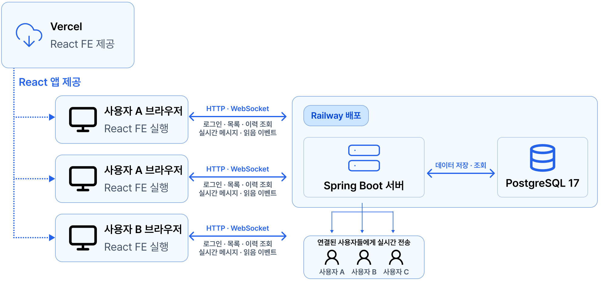
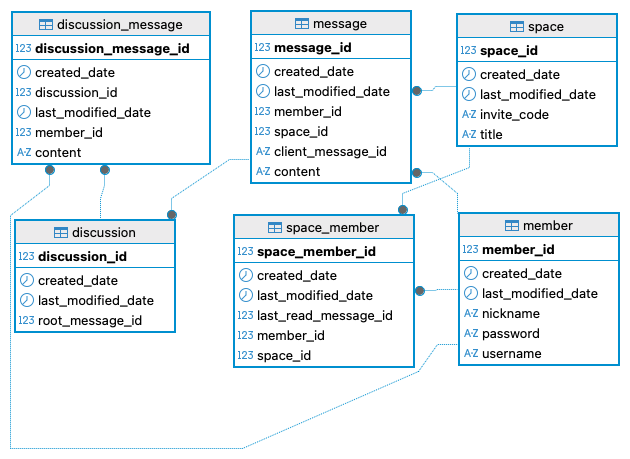
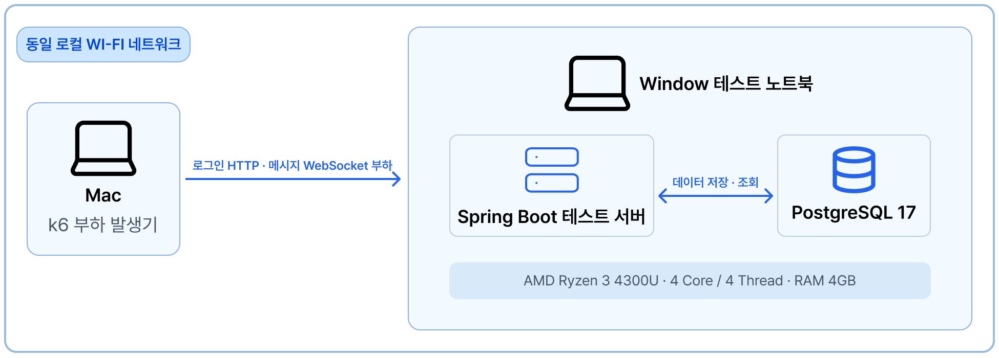

# Orbit Backend

Orbit은 Space에 참여한 사용자들이 실시간으로 메시지를 주고받고, 특정 메시지에서 Discussion을 이어갈 수 있는 채팅 시스템입니다. 이 저장소는 인증, Space·참여자 관리, 메시지·읽음 처리 등 백엔드 기능을 담당합니다.

[서비스 이용하기 ↗](https://app.orbitcorp.net/) · [프론트엔드 저장소 ↗](https://github.com/cjunhyeok/Orbit-FrontEnd)

## 주요 기능

- 회원가입·로그인 및 사용자 인증
- Space 생성, 초대 링크를 통한 참여와 참여자 관리
- WebSocket 기반 실시간 메시지 송수신
- 이전 메시지 조회 및 참여자별 읽음 상태 관리
- 특정 메시지에서 시작하는 Discussion

Space는 참여자들이 메시지를 주고받는 기본 공간이며, Discussion은 Space의 메시지 하나에서 시작하는 별도 대화입니다.

## 시스템 구성

## 핵심 데이터 구조

## 설계와 개선 사례

### [읽음 이벤트 병합·배치 · 계산상 전파 상한 약 99% 감소 ↗](https://witty-sheet-518.notion.site/99-ed160e9d7aa7837ebdc2815fb91b7aca)

### [동시 로그인 처리 · 재시도 포함 최종 실패율 10% 이상 → 0% ↗](https://witty-sheet-518.notion.site/10-0-3c360e9d7aa783e1a9cc011ade89df64)

### [읽음 저장 구조 전환 · 100 VU 메시지 처리 실패율 20% 이상 → 0% ↗](https://witty-sheet-518.notion.site/20-0-c9f60e9d7aa78280b73d01f795230e49)

## 기술

- Java 17 · Spring Boot · WebSocket
- Spring Data JPA · PostgreSQL
- JUnit 5 · k6 · Micrometer · Grafana

## 테스트 환경

- 기능 검증에는 JUnit 5를, 동시 로그인·메시지 처리 부하 검증에는 k6를 사용했습니다. 
- 성능 수치는 운영 환경이 아닌 위 테스트 환경에서 얻은 결과입니다.